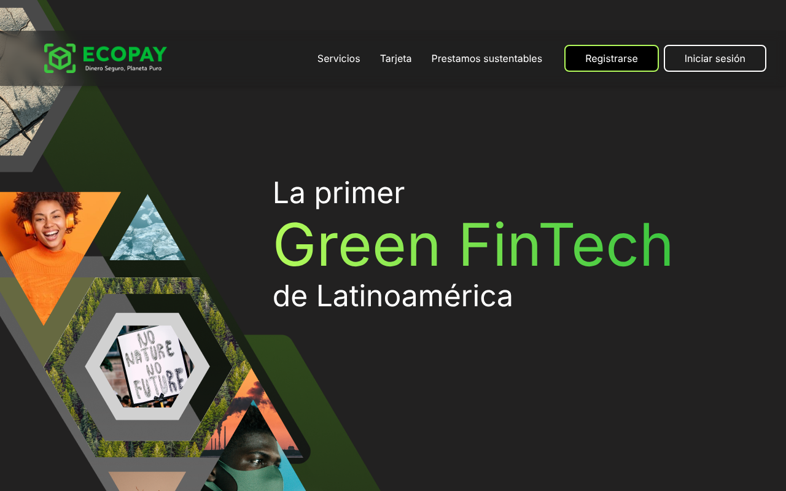
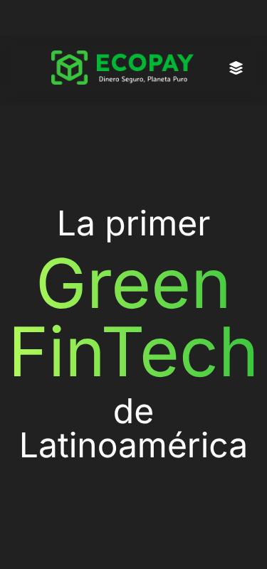
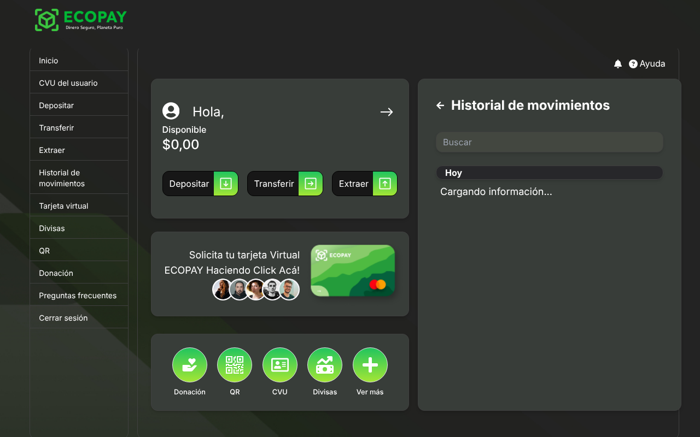
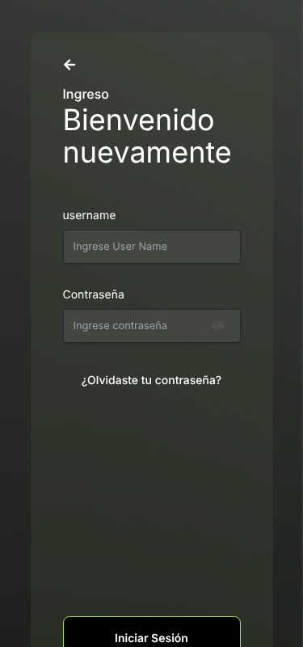

<h1 align="center">💸 EcoPay · Billetera digital ecológica ♻</h1>

<p align="center">
  Billetera virtual full stack (Spring Boot + React) creada por el equipo <b>s13-21-ft-java</b> de <a href="https://www.nocountry.tech/">No Country</a>.<br>
  <a href="https://s13-21-ft-java.vercel.app/">Demo</a> ·
  <a href="https://drive.google.com/file/d/1muqouh6NgJBvyqeK7ocU4OD4Qa_R5T6V/view?usp=sharing">Video</a> ·
  <a href="https://www.figma.com/file/JqeVizlLMPgJSF8Hi4iWQM/s13-21-ft-Java-Dise%C3%B1o?type=design&node-id=85-733&mode=design&t=MAb1QJJkOiGGJMGP-0">Figma</a> ·
  <a href="docs/STATUS.md">Estado</a>
</p>

<p align="center">
  
  
  
  
  <!-- Badges de CI y cobertura: se agregan con T-007 y T-006. Licencia: decisión pendiente del dueño. -->
</p>

<p align="center">
  <a href="https://s13-21-ft-java.vercel.app/"></a>
</p>

> ⚠️ **Estado:** el proyecto se está retomando para dejarlo como pieza de portfolio. Hay problemas de seguridad conocidos en curso de corrección (ver [docs/STATUS.md](docs/STATUS.md)). No uses datos reales.

## Qué es

EcoPay es una billetera virtual pensada para reducir el uso de papel, plástico y efectivo: registro e inicio de sesión, depósitos, extracciones, transferencias entre cuentas, historial de movimientos, tarjeta virtual y donaciones a ONG ambientales.

| Feature | Estado |
|---|---|
| Registro e inicio de sesión con JWT | ✅ |
| Depósito, extracción y transferencia por número de cuenta | ✅ |
| Historial de movimientos y detalle | ✅ |
| Tarjeta virtual | 🟡 parcial |
| Donaciones (extracción hacia ONG) | 🟡 parcial |
| Recuperar contraseña, login con Google, divisas, soporte | 🚧 en progreso ([ROADMAP](docs/ROADMAP.md)) |

| Escritorio | Mobile |
|---|---|
|  |  |
|  |  |

## Stack

| Parte | Tecnologías |
|---|---|
| Back (`Walam/`) | Java 17, Spring Boot 3.2.2 (Web, Data JPA, Security, Validation, Mail, Thymeleaf), JWT (jjwt 0.12.5), PostgreSQL, Lombok, MapStruct, springdoc-openapi 2.3.0, Maven Wrapper |
| Front (`Walam_Front/`) | React 18.2, Vite 5, React Router 6, Tailwind CSS 3, axios, Formik + Yup, Firebase |
| Infra local | Docker Compose: PostgreSQL 17, back y front en contenedores |

Arquitectura, modelo de datos y endpoints: [docs/ARCHITECTURE.md](docs/ARCHITECTURE.md).

## Levantar el proyecto en local

### Prerrequisitos

| Herramienta | Versión | Cómo comprobarla | Cómo instalarla |
|---|---|---|---|
| Git | cualquiera | `git --version` | https://git-scm.com/downloads |
| Docker + Compose | Docker 24+ con Compose v2 | `docker compose version` | https://docs.docker.com/get-docker/ |
| JDK (solo opción B) | 17 (también funciona con 21) | `java -version` | [SDKMAN](https://sdkman.io/): `sdk env install` en la raíz (lee `.sdkmanrc`) |
| Node.js (solo opción B) | 22 (lee `.nvmrc`) | `node -v` | [nvm](https://github.com/nvm-sh/nvm): `nvm install` en la raíz |

Para la **opción A** alcanza con Git y Docker.

### Configurar variables de entorno

Cada parte tiene un archivo de ejemplo **commiteado**; el archivo real está en `.gitignore`. **Los valores de ejemplo sirven tal cual para local** (coinciden con `docker-compose.yml`).

| Archivo de ejemplo | Copiar a | Quién lo lee | Qué contiene |
|---|---|---|---|
| `Walam/.env.example` | `Walam/.env` | back (spring-dotenv, desde el directorio `Walam/`) | `DB_URL`, `DB_USERNAME`, `DB_PASSWORD` |
| `Walam_Front/.env.example` | `Walam_Front/.env.local` | front (Vite) | `VITE_API_URL` (⚠️ hoy el código no la usa: [T-004](docs/tasks/T-004-api-base-url-from-env.md)) |

Desde la raíz del repo:

```bash
cp Walam/.env.example Walam/.env
```

```bash
cp Walam_Front/.env.example Walam_Front/.env.local
```

En producción hay que definir en el proveedor (Render): `DB_URL`, `DB_USERNAME`, `DB_PASSWORD` (y, cuando termine [T-001](docs/tasks/T-001-externalize-secrets.md), las del JWT y el mail). Detalle de cada variable: [docs/SETUP.md](docs/SETUP.md).

### Opción A · Todo en contenedores (la más simple)

Desde la raíz del repo:

```bash
docker compose --profile app up -d --build --wait
```

**Resultado esperado:** `Container walam-db-1 Healthy`, `walam-server-1` y `walam-client-1` `Started`/`Healthy`. El back tarda ~20 s en responder:

```bash
curl -s -o /dev/null -w '%{http_code}\n' http://localhost:8080/v3/api-docs
```

**Resultado esperado:** `200`. Front en http://localhost:5173 · Swagger en http://localhost:8080/swagger-ui/index.html.

Apagar y borrar los datos:

```bash
docker compose --profile app down -v
```

### Opción B · Desarrollo (DB en contenedor, back y front locales)

**Inicio rápido** (hace los pasos 3 a 7 y crea el usuario demo; `Ctrl+C` corta back y front):

```bash
./scripts/dev.sh
```

**Paso a paso:**

1. **Clonar.**
   ```bash
   git clone https://github.com/MatiasNicolasAcevedo/s13-21-ft-java.git
   ```
   ```bash
   cd s13-21-ft-java
   ```
   Resultado esperado: carpetas `Walam/` y `Walam_Front/`.
2. **Fijar versiones de Java y Node** (si usás SDKMAN y nvm; si no, alcanza con JDK 17+ y Node 22).
   ```bash
   sdk env install
   ```
   ```bash
   nvm install
   ```
   Resultado esperado: `java -version` muestra 17 y `node -v` muestra v22.
3. **Copiar los `.example`** (ver la sección anterior). Resultado esperado: existen `Walam/.env` y `Walam_Front/.env.local`.
4. **Levantar la DB.**
   ```bash
   docker compose up -d --wait
   ```
   Resultado esperado: `Container walam-db-1 Healthy`.
5. **Levantar el back** (deja la terminal ocupada; abrí otra para los pasos siguientes).
   ```bash
   cd Walam && ./mvnw spring-boot:run
   ```
   Chequeo, desde otra terminal:
   ```bash
   curl -s -o /dev/null -w '%{http_code}\n' http://localhost:8080/v3/api-docs
   ```
   Resultado esperado: `200` (tarda ~20 s la primera vez).
6. **Levantar el front** (otra terminal, desde la raíz).
   ```bash
   cd Walam_Front && npm ci && npm run dev
   ```
   Resultado esperado: `Local: http://localhost:5173/`. ⚠️ **Hoy falla la conexión con el back local:** el front llama a la API de producción hasta que se complete [T-004](docs/tasks/T-004-api-base-url-from-env.md).
7. **Crear el usuario de prueba e iniciar sesión** (no hay datos seed y la base se recrea en cada arranque del back).
   ```bash
   curl -s -X POST http://localhost:8080/auth/register -H 'Content-Type: application/json' -d '{"username":"demo","password":"Demo1234!","email":"demo@example.com"}'
   ```
   ```bash
   curl -s -X POST http://localhost:8080/auth/login -H 'Content-Type: application/json' -d '{"username":"demo","password":"Demo1234!"}'
   ```
   Resultado esperado: ambos devuelven `{"token":"eyJ..."}`.
8. **Verificar todo** (build + lint + tests).
   ```bash
   ./scripts/verify.sh
   ```
   Resultado esperado: `Resumen: server: ✅ build ✅ tests (...) · client: ✅ lint ✅ build ...`. ⚠️ **Hoy falla el lint del front:** ver [T-003](docs/tasks/T-003-fix-frontend-lint.md).
9. **Apagar y limpiar.** `Ctrl+C` en las terminales del back y del front, y después:
   ```bash
   docker compose down -v
   ```
   Resultado esperado: `Container walam-db-1 Removed` y `Volume walam_walam-db Removed`.

### Windows

- Usá **Git Bash** o **WSL** para los `.sh`; en PowerShell/CMD el back se levanta con `cd Walam` y `mvnw.cmd spring-boot:run`.
- Copiar archivos en CMD: `copy Walam\.env.example Walam\.env` y `copy Walam_Front\.env.example Walam_Front\.env.local`.
- Antes de clonar: `git config --global core.autocrlf input` (el repo usa LF; `.gitattributes` lo fuerza).

### Problemas frecuentes

| Síntoma | Causa | Solución |
|---|---|---|
| `./mvnw: Permission denied` | clon viejo sin el bit de ejecución | `chmod +x Walam/mvnw` o `sh mvnw ...` |
| `URL must start with 'jdbc'` al arrancar o testear el back | falta `Walam/.env` o corriste `./mvnw` fuera de `Walam/` | copiá el `.example` y corré desde `Walam/` |
| `Connection refused` a `localhost:5432` | la DB no está arriba | `docker compose up -d --wait` |
| `port is already allocated` (5432) | hay otro Postgres local | `DB_PORT=5433 docker compose up -d --wait` y en `Walam/.env` usá `localhost:5433` |
| Puerto 8080 o 5173 ocupado | otro proceso | cerralo o ver "Puertos" en [docs/SETUP.md](docs/SETUP.md) |
| El front muestra datos de otro lado / "Cargando información..." | el front apunta a producción | conocido: [T-004](docs/tasks/T-004-api-base-url-from-env.md) |
| Errores devuelven `403` en vez de `400/401/404` | `/error` bloqueado por Spring Security | conocido: [T-002](docs/tasks/T-002-lock-down-api.md) |
| Los usuarios desaparecen al reiniciar el back | `ddl-auto: create` recrea el esquema | conocido: [T-011](docs/tasks/T-011-flyway-baseline.md); volvé a registrar el demo |
| `toomanyrequests` al bajar imágenes de Docker | límite anónimo de Docker Hub | `docker login` o reintentar más tarde |

Verificado el 2026-10-10 en Ubuntu 24.04 con Java 21.0.12 (y 17.0.20 en contenedor), Node 22.22.0, Docker 29.8.2 / Compose 5.6.0. La opción A se verificó con imágenes construidas desde estos `Dockerfile`s (el proxy del entorno de verificación exigió inyectar su CA; ver la auditoría).

## Tests y calidad

```bash
./scripts/verify.sh
```

Opciones `--server` y `--client`; los logs quedan en `.verify-logs/`. Hoy hay 1 test de back (cobertura de línea 11 %) y ninguno de front. Estrategia, convenciones y cómo correr un solo test: [docs/TESTING.md](docs/TESTING.md).

## Cómo se trabaja

GitHub Flow con Conventional Commits y un PR por tarea: [CONTRIBUTING.md](CONTRIBUTING.md). El repo está preparado para desarrollo asistido por agentes ([AGENTS.md](AGENTS.md)): 🤖 el agente gratuito de IntelliJ para tareas chicas y 🧠 un modelo de frontera para lo complejo, con el tablero en [docs/BACKLOG.md](docs/BACKLOG.md).

## Estado y roadmap

[docs/STATUS.md](docs/STATUS.md) · [docs/ROADMAP.md](docs/ROADMAP.md) · [Auditoría inicial](docs/audits/2026-10-10-initial.md)

Recursos originales del equipo: [prototipo en Figma](https://www.figma.com/proto/JqeVizlLMPgJSF8Hi4iWQM/s13-21-ft-Java-Dise%C3%B1o?node-id=1166-989&scaling=scale-down) · [colección de Postman](https://drive.google.com/file/d/1V16jwVYbMnqIDw6iH2M6pC28MOALSR4A/view?usp=drive_link) · [DER](https://i.ibb.co/tYnTpxz/ingenieria-inversa-der.png) · [diagrama en draw.io](https://app.diagrams.net/#G1F_qXfrsFEWTUob3Hx7nafSsru8PtKZfG).

## Equipo y licencia

Hecho en No Country (cohorte s13-21, 2024) por:

| Rol | Integrantes |
|---|---|
| Back-End | [Matias Acevedo](https://github.com/MatiasNicolasAcevedo) (mantenedor), [Juan Ortega](https://github.com/Full-Juan-Ortega), [Valerie Ramos](https://github.com/valeday), [Dario Benitez](https://github.com/DDarioBenitez), [Joshua Frias](https://github.com/joshuaFrias95), [Josue Zorrilla](https://github.com/josuejs23), [Leonardo Cortés](https://github.com/leosirx), [Enzo Sierra](https://github.com/enzogsierra), [Alejandro Pacheco](https://github.com/JAPMagdaleno) |
| Front-End | [Leandro Rossi](https://github.com/leandrofrossi), [Diana Castaño](https://github.com/Natsumychan), [Jorge Beja](https://github.com/JornabeDV), [Ricar Patiño](https://github.com/patinoricar) |
| UX/UI | [Diego Gonzalez](https://www.linkedin.com/in/diego-gonzalez-7937aa16/), [Yuli Riveros](https://www.linkedin.com/in/yuliriverosortiz/) |
| Testing | [Ariadna Menendez](https://www.linkedin.com/in/ariadna-menendez/) |

Licencia: pendiente de definir por el dueño del repo (ver [docs/STATUS.md](docs/STATUS.md)).
