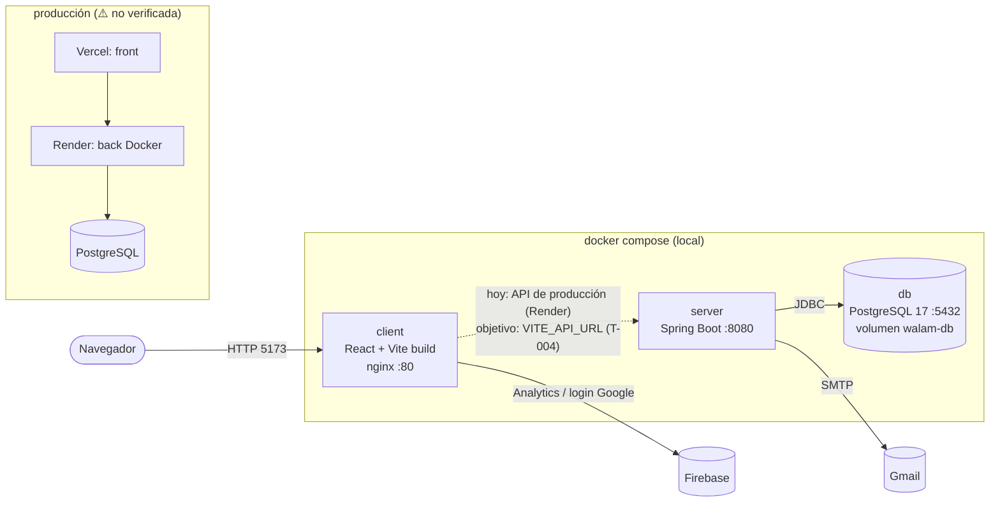
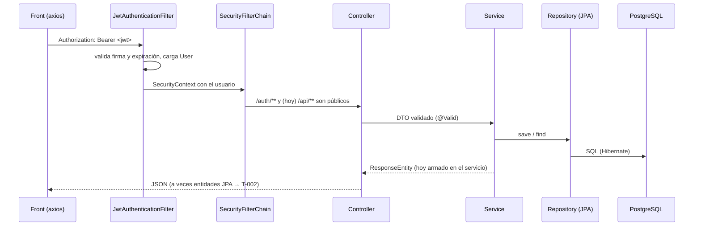
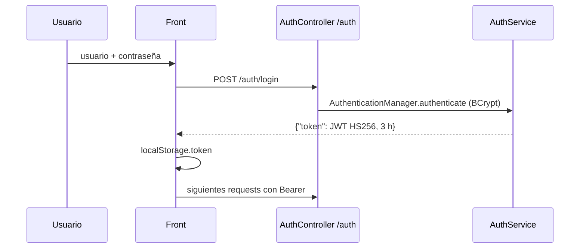
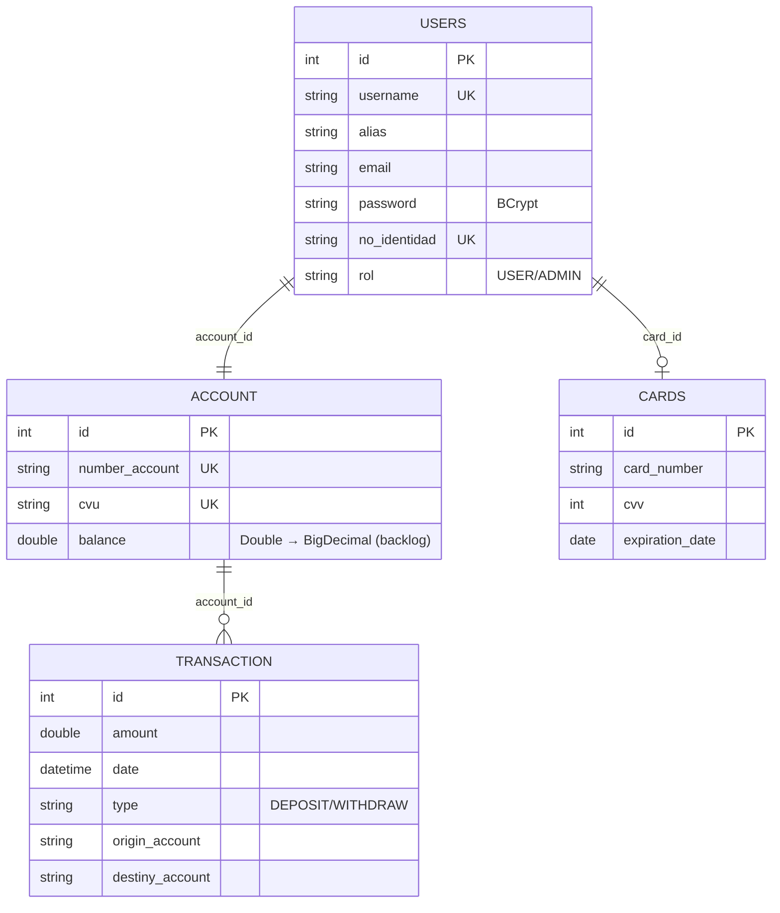

# Arquitectura

## Componentes (incluidos los contenedores locales)

## Flujo de una request

## Autenticación

Registro (`POST /auth/register`): crea `User` (rol USER, password BCrypt), alias aleatorio `palabra.palabra.eco`, `Account` con número de cuenta y CVU aleatorios, saldo 0, y devuelve un JWT. Problemas conocidos: secreto hardcodeado (T-001), `/api/**` público (T-002).

## Modelo de datos

También existen `account_card` y `user_support_ticket` sin uso desde la API. Esquema generado por Hibernate (`ddl-auto: create`), sin migraciones (T-011).

## Endpoints principales y pantalla que los usa
| Método y ruta | Auth hoy | Pantalla |
|---|---|---|
| `POST /auth/register` | pública | Register |
| `POST /auth/login` | pública | Login |
| `GET /api/v1/users` (usuario logueado) | token | Dashboard, CVU, Tarjeta, Historial, Datos |
| `PUT /api/v1/user-update` | token | UsersDataForm |
| `POST /api/v1/deposit` · `/withdraw` · `/transfer` | token | VirtualCashier, Donate, Transfer |
| `GET /api/v1/transaction/{id}` | 🔴 pública | HistoryDetails |
| `POST /api/v1/card/create` | token | Dashboard |
| `GET /api/v1/users-all`, `/user/{id}`, `/transactions` | 🔴 públicas | ninguna |
| `PATCH /api/v1/user/update-*` (8) | token | ninguna |
| `/send-email/*`, `/account/*`, `/api/v1/demo` | token | ninguna (pruebas/a medias) |
Contrato completo: `http://localhost:8080/v3/api-docs` (springdoc).

## Arquitectura objetivo
- Tests de integración contra PostgreSQL real con Testcontainers → [ADR 0001](adr/0001-testcontainers-over-h2.md).
- Migración de versiones en pasos chicos protegidos por tests → [ADR 0002](adr/0002-upgrade-path.md).
- JWT stateless con secreto por entorno, `/api/**` autenticado, DTOs de respuesta (nunca entidades), errores `ProblemDetail` → T-001, T-002.
- Esquema versionado con Flyway → T-011.
- Front con un único cliente HTTP configurado por `VITE_API_URL` → T-004.
